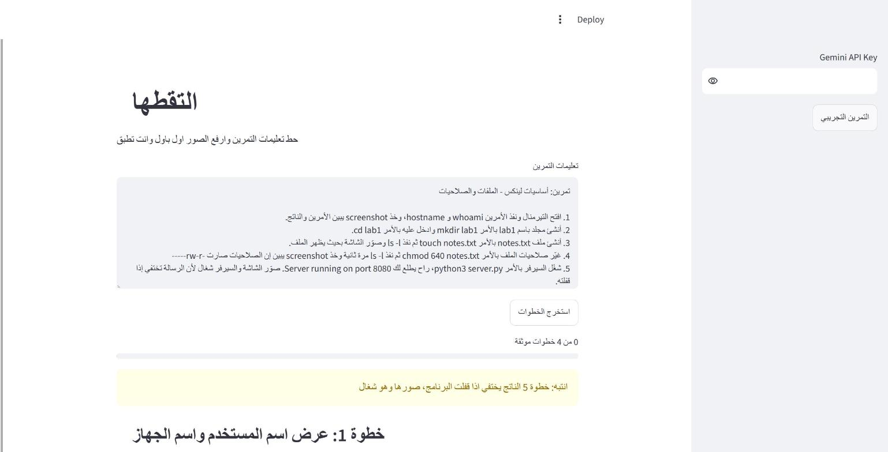
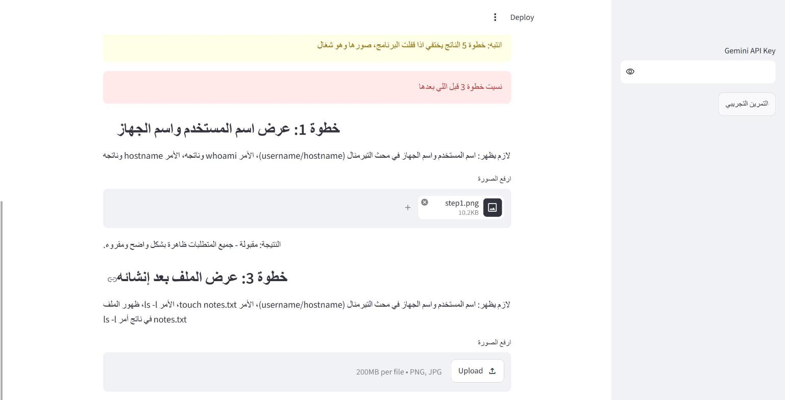
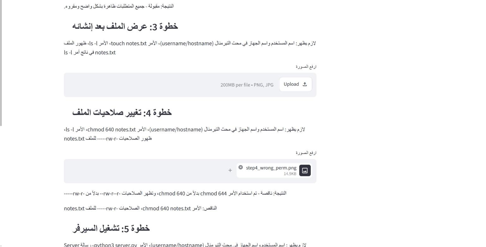
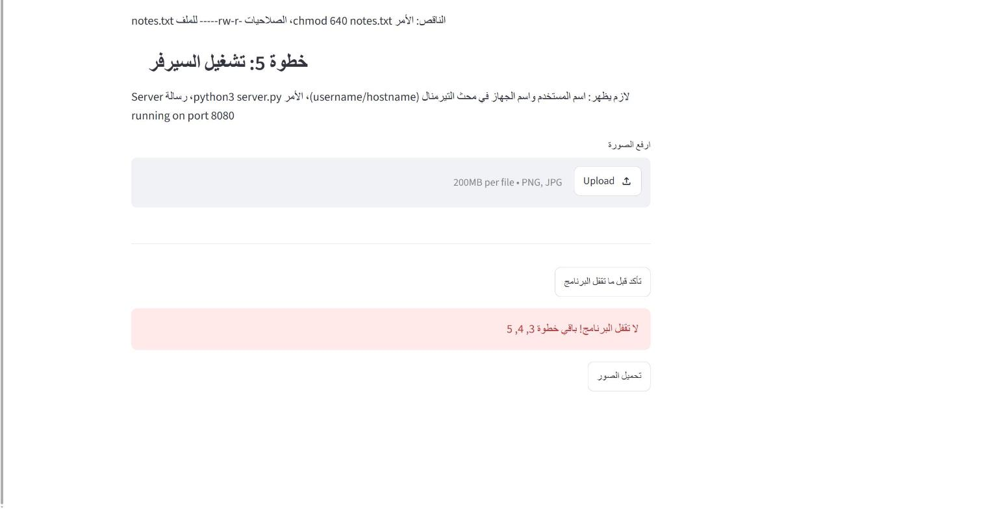

# التقطها

هذا مشروعي النهائي في معسكر مسار القمة (مسار التقنيات الناشئة).

الفكرة جات من شي يصير معي كثير، اخلص التمرين العملي وبعدين انتبه اني ما صورت خطوة مطلوبة في التقرير، واذا قفلت البرنامج بعض النتايج تروح (مثل رسالة ان السيرفر شغال) فارجع اعيد التمرين كله عشان صورة وحدة.

التطبيق تفتحه جنب البرنامج اللي تشتغل عليه، تلصق فيه تعليمات التمرين ويطلع لك الخطوات اللي تبي صور ووش لازم يبان في كل صورة. كل ما تخلص خطوة صورها وارفعها ويقولك اذا هي تمام ولا ناقصها شي، وقبل ما تقفل البرنامج اضغط "تأكد قبل ما تقفل البرنامج" عشان تتطمن ان ما فيه شي ناقص.

## طريقة التشغيل

```
pip install -r requirements.txt
streamlit run app.py
```

بعدها حط الـ API key حق Gemini في الخانة اللي على الجنب. واذا ما عندك مفتاح عادي يشتغل، بس الخطوات بيطلعها من الكلمات (screenshot او صور) والصور بتراجعها انت بنفسك.

ملاحظة: النسخة المجانية من Gemini فيها حد للطلبات بالدقيقة، فاذا علق شوي انتظر لانه يعيد المحاولة لحاله.

## كيف جربته

سويت 10 صور لتمرين لينكس، 4 كاملة و 6 كل وحدة فيها غلط مختلف (مثلا الناتج بدون الامر، صلاحيات غلط، صورة مغبشة)، وكتبت سكربت يشغل التطبيق عليها ويقارن مع النتيجة الصح اللي حاطها في `tests/expected.csv`.

```
python tests/make_test_images.py
set GEMINI_API_KEY=...
python tests/test_accuracy.py
```

طلع 10 من 10 صح وكشف الست الناقصة كلها. بس الصور هذي انا سويتها وواضحة، الصور الحقيقية ممكن تكون اصعب. النتايج كاملة في `tests/results.csv`.

## صور من التطبيق





